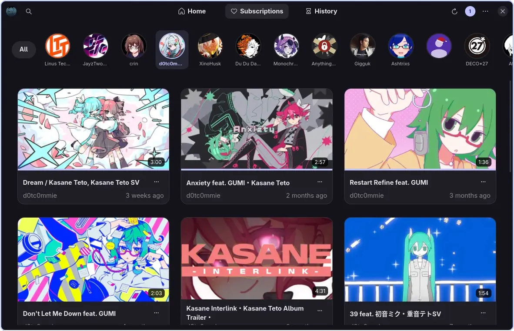
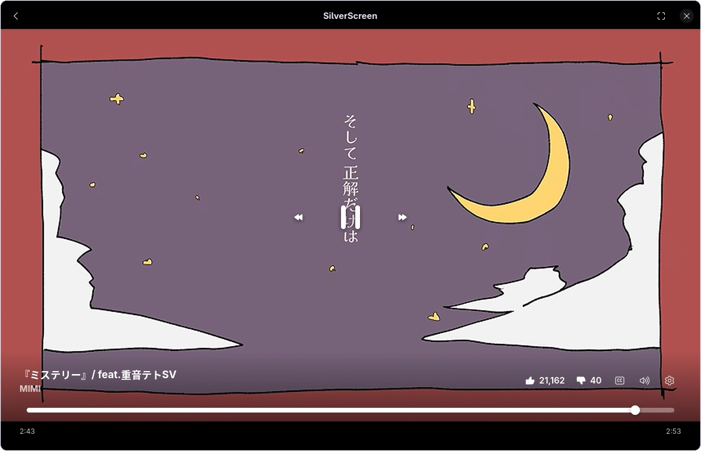
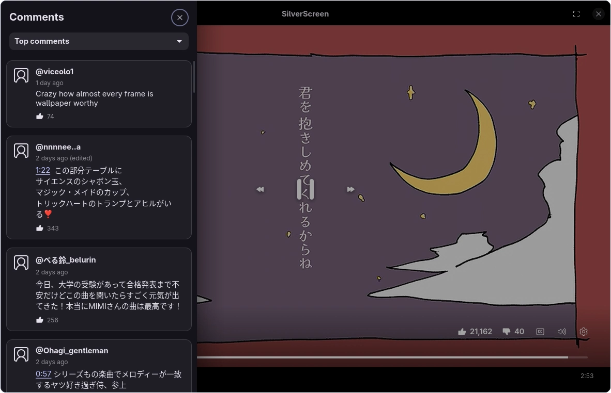

# SilverScreen

A GTK 4 / Libadwaita YouTube client for Linux. It uses `yt-dlp` to grab streams and plays them through a built-in player (or an external `mpv` window if you prefer). 

This is an early alpha. Expect bugs. I build and test this on CachyOS, so other distros might be hit or miss.

It supports personalized feeds but you can also use it without an account. If you sign in, you get access to your Home feed, Subscriptions, and Watch History. if you don't you still can search videos, browse channels, or just paste links directly.  it'll store your session in your system keyring.

It also has a basic queue, SponsorBlock support, comments, dislikes/likes (via RYD), and Discord Rich Presence.

## Screenshots

<table>
  <thead>
    <tr>
      <th width="33.3%" align="center">Subscriptions</th>
      <th width="33.3%" align="center">Player</th>
      <th width="33.3%" align="center">Comments</th>
    </tr>
  </thead>
  <tbody>
    <tr>
      <td><a href="screenshots/Subscriptions.webp"></a></td>
      <td><a href="screenshots/Player.webp"></a></td>
      <td><a href="screenshots/Comments.webp"></a></td>
    </tr>
  </tbody>
</table>

## Install

The install script pulls dependencies, clones the repo, and builds the app. On Arch it uses makepkg and pacman; on other distros it installs to /usr/local (or ~/.local if you pass --user).

```sh
curl -fsSL https://raw.githubusercontent.com/XSilverTH/SilverScreen/master/packaging/install.sh | sh

```

To uninstall:

```sh
curl -fsSL https://raw.githubusercontent.com/XSilverTH/SilverScreen/master/packaging/install.sh | sh -s -- --uninstall

```

## Building manually

you'll need .NET 10 SDK, blueprint-compiler, clang, glib2, gtk4, libadwaita, webkitgtk-6.0, libsoup3, libsecret, mpv, and yt-dlp.

```sh
git clone --recurse-submodules https://github.com/XSilverTH/SilverScreen.git
cd SilverScreen

dotnet publish src/SilverScreen.App/SilverScreen.App.csproj /p:DebugType=None /p:DebugSymbols=false -o publish
```

## Todo

* Posting comments (reading them in the sidebar already works)

* Downloading videos for offline playback

* Youtube playlist support

## License

[GPLv3](LICENSE)
